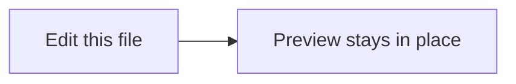

# Acceptance check

Automated tests already cover behavior (unit, integration, preview runtime,
local-only, demo render). This is only a quick look at what can be seen on
screen. Start with `demo.md` in the folder root (preview and PDF export), then
open this file and its preview with **Markdown Studio: Preview: Open Beside**.

> [!NOTE]
> This box should be a blue "Note" alert, and the top of this page should be a
> small YAML box (not a big heading).

> [!WARNING]
> This one should be an amber "Warning" alert.

1. In the preview, press `Cmd+F` / `Ctrl+F` and search for `acceptance`.
2. Click [the linked page](linked.md#second-section). It should open in the editor at "Second section".
3. Open [skills/sample-skill/SKILL.md](../skills/sample-skill/SKILL.md) and preview it: the top should be a card with the skill name.
4. Open [skills/BadName/SKILL.md](../skills/BadName/SKILL.md): the Problems panel should list Agent Skills warnings.
5. Select the preview tab and run **Markdown Studio: PDF: Export**. The PDF is written next to the file.
   If no Chromium is installed anywhere on this machine, it first *asks* before downloading; "Not now" downloads nothing.
6. Optional: Settings → search `showEditorTitleButton` → turn it on. A preview button appears at the top right of Markdown editors.

