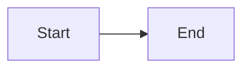
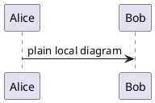

# Local-only probe

Every construct below tries to load something from `example.com` or
`tracker.example`. With the default settings none of them may reach the
network. Only the image vectors are allowed when `example.com` is allowlisted.


<picture><source srcset="https://example.com/picture.webp"></picture>

<link rel="stylesheet" href="https://tracker.example/style.css">
<link rel="prefetch" href="https://tracker.example/prefetch">
<link rel="preconnect" href="https://tracker.example">

<style>
@import url("https://tracker.example/import.css");
.bg { background-image: url("https://tracker.example/bg.png"); }
@font-face { font-family: probe; src: url("https://tracker.example/font.woff2"); }
.probe-font { font-family: probe; }
</style>

<div class="bg probe-font" style="border-image: url('https://tracker.example/inline-style.png') 30">styled</div>

<iframe src="https://tracker.example/frame"></iframe>
<script src="https://tracker.example/script.js"></script>
<video src="https://tracker.example/video.mp4" autoplay></video>
<audio src="https://tracker.example/audio.mp3" autoplay></audio>
<object data="https://tracker.example/object.svg"></object>
<embed src="https://tracker.example/embed.svg">

[external link](https://tracker.example/link) — links must never be fetched.

```svg
<svg xmlns="http://www.w3.org/2000/svg" xmlns:xlink="http://www.w3.org/1999/xlink" width="120" height="40">
  <image href="https://tracker.example/svg-image.png" width="40" height="40"/>
  <image xlink:href="https://tracker.example/svg-xlink.png" x="40" width="40" height="40"/>
  <rect x="80" width="40" height="40" fill="url(https://tracker.example/pattern.svg#p)"/>
</svg>
```



```plantuml
@startuml
!include https://tracker.example/include.puml
Alice -> Bob : 
@enduml
```


